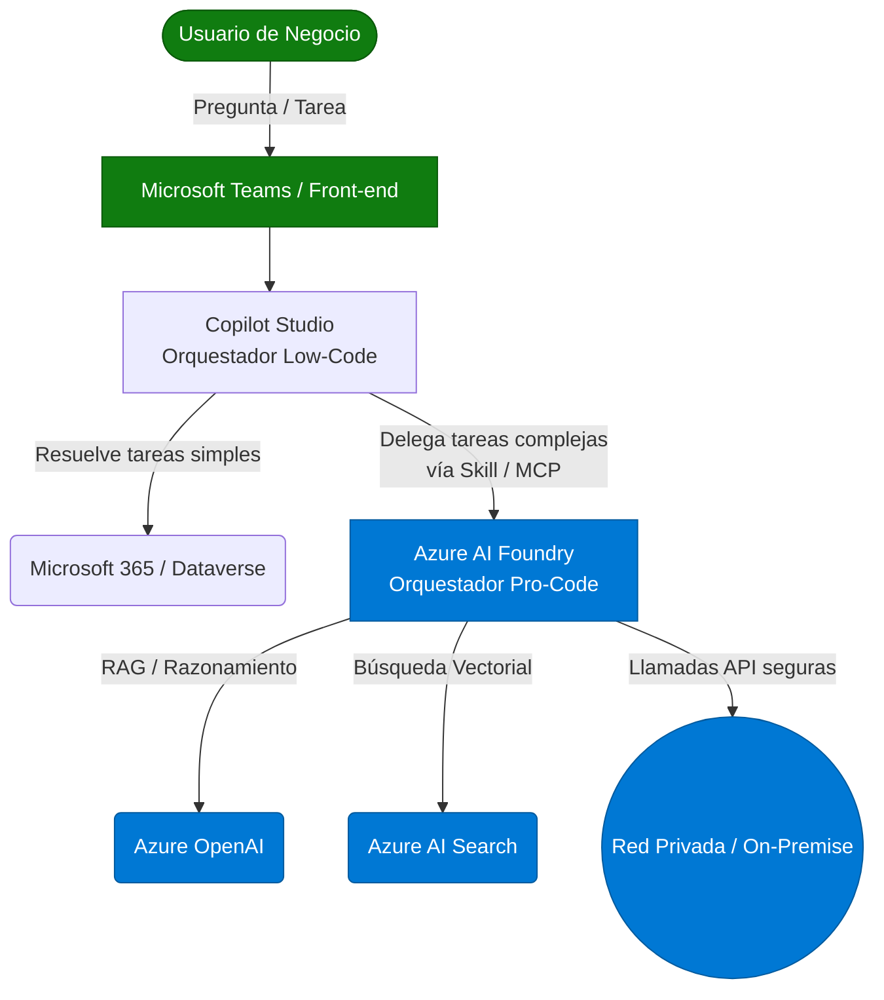

La Inteligencia Artificial ha dado un salto evolutivo. Ya no hablamos solo de "copilotos" que nos ayudan a redactar correos o resumir documentos. Ahora hablamos de **Agentes Autónomos**: sistemas capaces de razonar, tomar decisiones y ejecutar acciones en múltiples sistemas sin supervisión humana constante.

Microsoft ha liderado esta transición, pero lo ha hecho dividiendo su ecosistema en dos grandes plataformas: **Copilot Studio** y **Azure AI Foundry**. 

Si eres un arquitecto cloud, un Tech Lead o un ingeniero DevOps, es muy probable que te hayas preguntado: *"¿Cuál de las dos herramientas debo usar para el próximo proyecto de mi empresa?"* 

En este artículo, vamos a destripar ambas plataformas y ver cómo, en muchos casos, la mejor respuesta es una arquitectura híbrida.

## Copilot Studio: La democratización del Agente

Originalmente pensado para *chatbots* sencillos (heredero de Power Virtual Agents), **Copilot Studio** ha evolucionado hasta convertirse en el orquestador "low-code" por excelencia de Microsoft.

### ¿Para qué es ideal?
- **Desarrollo rápido (Low-code/No-code):** Si necesitas que los *Citizen Developers* o usuarios de negocio puedan modificar el comportamiento del agente sin escribir código.
- **Integración con el ecosistema Microsoft 365:** Viene con conectores nativos para SharePoint, Teams, Dynamics y Dataverse.
- **Flujos de negocio:** Excelente para casos de uso como automatización de RRHH, soporte IT interno o procesos de ventas.

### La gran novedad: Soporte MCP
Recientemente, Microsoft ha introducido el soporte para el **Model Context Protocol (MCP)** en Copilot Studio. Esto cambia las reglas del juego. Ahora, un agente creado con "cajas y flechas" puede conectarse a un servidor MCP externo para realizar acciones complejas, como consultar tu clúster de Kubernetes, auditar accesos en Entra ID, o reiniciar un pipeline de CI/CD.

## Azure AI Foundry: El control absoluto

Si Copilot Studio es un coche automático con ayudas a la conducción, **Azure AI Foundry** (anteriormente Azure AI Studio) es un Fórmula 1 con telemetría completa. Está diseñado para desarrolladores profesionales (Pro-code) y científicos de datos.

### ¿Para qué es ideal?
- **Control granular de modelos:** Si necesitas hacer *Fine-Tuning* específico, cambiar hiperparámetros o usar modelos open-source (Llama, Mistral) en lugar de OpenAI.
- **Lógica compleja (Orquestadores Pro-code):** Ideal si prefieres escribir código Python usando frameworks como Semantic Kernel, LangChain o AutoGen para definir cómo razona tu agente.
- **Escalabilidad y Seguridad Enterprise:** Cuando el agente forma parte de un producto core que recibirá miles de peticiones por segundo, respaldado por la infraestructura y las políticas estables de Azure (Azure Policies, Private Endpoints).

*Ejemplo: Para los equipos DevOps, la mayor ventaja de AI Foundry es que todo se gestiona como infraestructura (IaC). Aquí tienes un snippet de cómo levantar el core de un proyecto seguro en Terraform:*

```hcl
resource "azurerm_cognitive_account" "openai" {
  name                = "oai-agents-prod"
  location            = azurerm_resource_group.rg.location
  resource_group_name = azurerm_resource_group.rg.name
  kind                = "OpenAI"
  sku_name            = "S0"
  
  custom_subdomain_name         = "oai-agents-prod"
  public_network_access_enabled = false # Seguridad por defecto
}

resource "azurerm_search_service" "ai_search" {
  name                = "srch-agents-prod"
  resource_group_name = azurerm_resource_group.rg.name
  location            = azurerm_resource_group.rg.location
  sku                 = "standard"
  local_authentication_enabled = false # Solo RBAC (Entra ID)
}
```

## Arquitectura Híbrida: Lo mejor de ambos mundos

En implementaciones maduras (y aquí es donde entra nuestro gorro de Arquitectos Cloud), rara vez es un escenario de "blanco o negro". La tendencia actual es construir arquitecturas híbridas.

**¿Cómo funciona esto?**



1. Utilizas **Copilot Studio** como la interfaz principal y el orquestador de nivel superior. Esto permite integrarlo fácilmente en Teams o portales internos y delegar la lógica de negocio simple a los usuarios finales.
2. Para las tareas pesadas (consultas complejas de RAG sobre terabytes de documentos técnicos, llamadas a APIs seguras on-premise, o razonamiento avanzado), Copilot Studio delega la acción a una "Habilidad" (Skill) respaldada por **Azure AI Foundry**.

De esta manera, mantienes la agilidad en el front-end y la gobernanza estricta en el back-end.

## Conclusión

El ecosistema de agentes de Microsoft no compite entre sí; se complementa. Si el caso de uso es interno, rápido y muy pegado a Microsoft 365, ve por Copilot Studio. Si estás construyendo el core de tu producto SaaS o necesitas IA altamente customizada, Azure AI Foundry es tu terreno.

¿Tú con cuál te quedas para tu próximo proyecto? ¡Déjalo en los comentarios!
